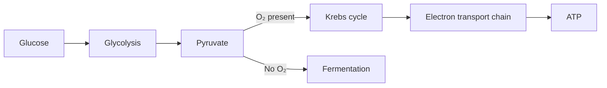
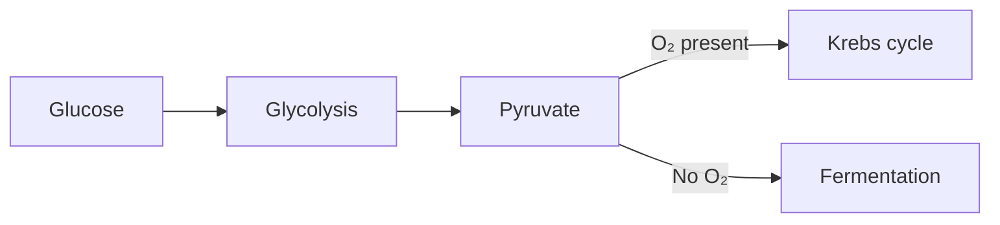
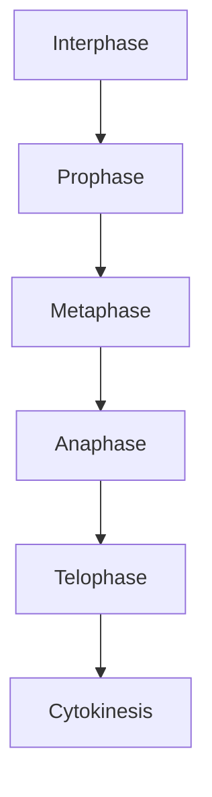

# Diagrams & equations

Built-in ways to add visuals to a page using plain markdown. No images needed.

## Flowcharts and process diagrams

Write a ` ```mermaid ` code block and it becomes a diagram ([Mermaid syntax](https://mermaid.js.org/intro/)). Colours follow the site theme, including dark mode.



````md

````

Top-to-bottom works too. Use `flowchart TD`:



## Equations

Use `$...$` for inline maths and `$$...$$` for a centred equation.

The overall equation for aerobic respiration:

$$
\mathrm{C_6H_{12}O_6 + 6O_2 \longrightarrow 6CO_2 + 6H_2O + energy}
$$

Photosynthesis is roughly the reverse: $\mathrm{6CO_2 + 6H_2O \xrightarrow{light} C_6H_{12}O_6 + 6O_2}$.

Hardy–Weinberg equilibrium: $p^2 + 2pq + q^2 = 1$.

```md
$$
\mathrm{C_6H_{12}O_6 + 6O_2 \longrightarrow 6CO_2 + 6H_2O + energy}
$$

Hardy–Weinberg: $p^2 + 2pq + q^2 = 1$
```

## Callouts

::: tip Remember
ATP is the immediate energy source for cellular processes.
:::

::: info
Prokaryotes have 70S ribosomes; eukaryotes have 80S ribosomes in the cytoplasm.
:::

::: warning Common mistake
Diffusion does **not** require ATP. Active transport does.
:::

::: danger Lab safety
Always wear goggles when handling hydrochloric acid.
:::

::: details Show worked answer
Water potential of pure water is 0 kPa; adding solute makes it more negative.
:::

```md
::: tip Remember
ATP is the immediate energy source for cellular processes.
:::

::: warning Common mistake
Diffusion does **not** require ATP.
:::

::: details Show worked answer
...
:::
```

## Tables

| Feature | Mitosis | Meiosis |
|---|---|---|
| Number of divisions | 1 | 2 |
| Daughter cells | 2 | 4 |
| Chromosome number | Diploid (2n) | Haploid (n) |
| Genetically identical? | Yes | No |

## Quotes

> "Nothing in biology makes sense except in the light of evolution."
> — Theodosius Dobzhansky
